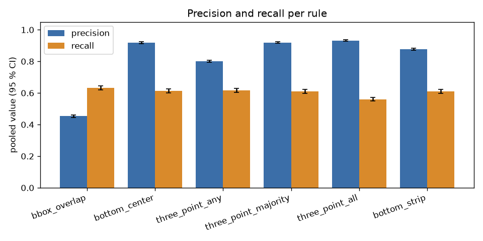
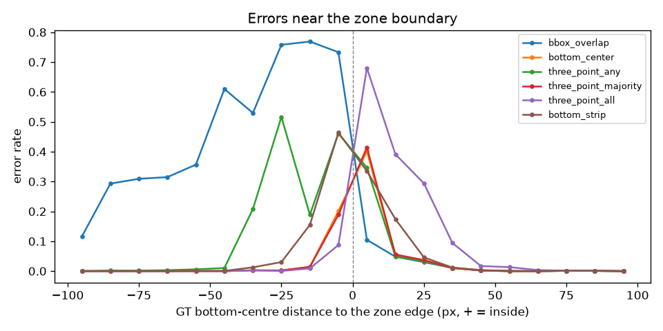
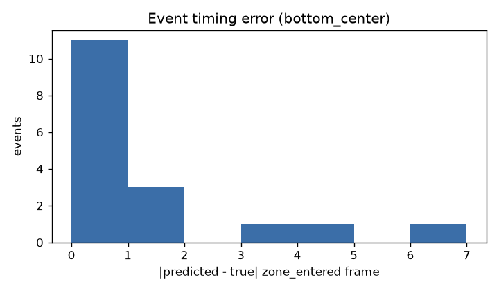

# Evaluation report e1-mot17-derived-2026-11-05

> **Sanity check only.** At least one zone uses `source=derived` ground truth
> (MOT17 GT box bottom-centre inside the polygon). That definition is the
> `bottom_center` rule applied to the GT box, so it favours the foot-point
> rules and must not be used for the headline comparison (spec I.3).

| Item | Value |
|---|---|
| Started (UTC) | 2026-11-05T14:22:18.684668+00:00 |
| Host / platform | MacBook-Air-Ten.local / macOS-26.2-arm64-arm-64bit |
| Device | mps |
| Model SHA-256 | f59b3d833e2ff32e194b5bb8e08d211dc7c5bdf144b90d2c8412c47ccfc83b36 |
| Git commit | a1e25a80d0a6ccb43e99f3c7971866ae05e42854 |
| Config SHA-256 | 85a4fb0d5ff846881bcaa5c72cd613edd9194df9d833d4229df4f79cadcc991d |
| Sequences | MOT17-02, MOT17-04, MOT17-09 |
| Detector | conf 0.3, imgsz 640 |
| Matching | IoU 0.5, classes [1], min visibility 0.25 |
| State machine / tolerance | 3 in / 5 out, ±10 frames |
| Bootstrap | 5000 resamples, seed 1234 |
| Invariant violations | 0 |
| GT persons without a label (treated as ignore) | 0 |

## Per-person membership, pooled over all sequences and zones

| Rule | Precision [95 % CI] | Recall [95 % CI] | F1 [95 % CI] | FPR | Recall (matched) | TP | FP | FN | FN missed det. | Event P | Event R | Event F1 | Dup. rate |
|---|---|---|---|---|---|---|---|---|---|---|---|---|---|
| bbox_overlap | 0.454 [0.446, 0.462] | 0.632 [0.619, 0.645] | 0.528 [0.521, 0.535] | 0.204 | 0.983 | 12214 | 14712 | 7120 | 6904 | 0.500 | 0.304 | 0.378 | 0.000 |
| bottom_center | 0.919 [0.913, 0.924] | 0.613 [0.600, 0.626] | 0.735 [0.725, 0.745] | 0.015 | 0.953 | 11846 | 1049 | 7488 | 6904 | 0.630 | 0.739 | 0.680 | 0.000 |
| three_point_any | 0.802 [0.795, 0.809] | 0.616 [0.604, 0.629] | 0.697 [0.688, 0.705] | 0.041 | 0.958 | 11914 | 2936 | 7420 | 6904 | 0.538 | 0.609 | 0.571 | 0.038 |
| three_point_majority | 0.919 [0.914, 0.925] | 0.611 [0.599, 0.624] | 0.734 [0.725, 0.744] | 0.014 | 0.951 | 11821 | 1035 | 7513 | 6904 | 0.583 | 0.609 | 0.596 | 0.000 |
| three_point_all | 0.932 [0.927, 0.937] | 0.560 [0.549, 0.572] | 0.700 [0.690, 0.709] | 0.011 | 0.871 | 10827 | 788 | 8507 | 6904 | 0.517 | 0.652 | 0.577 | 0.000 |
| bottom_strip | 0.878 [0.871, 0.884] | 0.610 [0.598, 0.622] | 0.720 [0.710, 0.729] | 0.023 | 0.949 | 11793 | 1645 | 7541 | 6904 | 0.538 | 0.609 | 0.571 | 0.000 |

Recall counts persons the detector missed as FN (`FN missed det.`); *Recall (matched)*
leaves them out, so it isolates the rule from the detector.

### E1 check on this data source

| Rule | Precision gain vs bbox_overlap | CIs separated | Recall loss | Meets E1 |
|---|---|---|---|---|
| bottom_center | 0.465 | True | 0.019 | True |
| three_point_any | 0.349 | True | 0.016 | True |
| three_point_majority | 0.466 | True | 0.020 | True |
| three_point_all | 0.479 | True | 0.072 | False |
| bottom_strip | 0.424 | True | 0.022 | True |

E1 needs the criterion on at least 2 of 3 data sources (MOT17, WILDTRACK, own
recordings); this table covers one.

## Per sequence and zone (precision / recall / F1)

| Sequence | Zone | bbox_overlap | bottom_center | three_point_any | three_point_majority | three_point_all | bottom_strip |
|---|---|---|---|---|---|---|---|
| MOT17-02 | corner | 0.000 / - / 0.000 | - / - / - | 0.000 / - / 0.000 | - / - / - | - / - / - | - / - / - |
| MOT17-02 | irregular | 0.654 / 0.291 / 0.402 | 0.941 / 0.289 / 0.442 | 0.899 / 0.291 / 0.439 | 0.941 / 0.289 / 0.442 | 0.946 / 0.276 / 0.427 | 0.920 / 0.290 / 0.441 |
| MOT17-02 | strip | 0.561 / 0.818 / 0.666 | 0.878 / 0.813 / 0.844 | 0.858 / 0.814 / 0.836 | 0.878 / 0.813 / 0.844 | 0.917 / 0.798 / 0.853 | 0.847 / 0.807 / 0.826 |
| MOT17-04 | corner | 0.367 / 0.518 / 0.429 | 0.943 / 0.515 / 0.666 | 0.846 / 0.517 / 0.641 | 0.943 / 0.515 / 0.666 | 0.955 / 0.471 / 0.631 | 0.954 / 0.441 / 0.603 |
| MOT17-04 | irregular | 0.669 / 0.896 / 0.766 | 0.962 / 0.885 / 0.922 | 0.912 / 0.895 / 0.904 | 0.962 / 0.885 / 0.922 | 0.981 / 0.733 / 0.839 | 0.932 / 0.853 / 0.890 |
| MOT17-04 | strip | 0.345 / 0.937 / 0.504 | 0.901 / 0.805 / 0.851 | 0.581 / 0.805 / 0.675 | 0.901 / 0.805 / 0.851 | 0.903 / 0.805 / 0.851 | 0.842 / 0.890 / 0.865 |
| MOT17-09 | corner | 0.008 / 0.750 / 0.015 | 0.361 / 0.650 / 0.464 | 0.133 / 0.650 / 0.220 | 0.308 / 0.200 / 0.242 | 0.000 / 0.000 / 0.000 | 0.256 / 0.550 / 0.349 |
| MOT17-09 | irregular | 0.222 / 0.910 / 0.358 | 0.852 / 0.894 / 0.872 | 0.653 / 0.908 / 0.759 | 0.847 / 0.858 / 0.852 | 0.862 / 0.646 / 0.739 | 0.695 / 0.880 / 0.776 |
| MOT17-09 | strip | 0.600 / 0.887 / 0.716 | 0.893 / 0.883 / 0.888 | 0.822 / 0.887 / 0.854 | 0.893 / 0.883 / 0.888 | 0.894 / 0.810 / 0.850 | 0.850 / 0.883 / 0.866 |

## Detector (YOLOv8n) against MOT17 boxes at IoU 0.5

| Sequence | Frames | GT persons | Matched | Recall | Precision |
|---|---|---|---|---|---|
| MOT17-02 | 600 | 9393 | 3873 | 0.412 | 0.841 |
| MOT17-04 | 1050 | 39821 | 18095 | 0.454 | 0.911 |
| MOT17-09 | 525 | 3745 | 3279 | 0.876 | 0.885 |

## Frame-level occupancy, pooled

| Rule | TP | FP | FN | TN | Precision | Recall |
|---|---|---|---|---|---|---|
| bbox_overlap | 4541 | 1810 | 0 | 174 | 0.715 | 1.000 |
| bottom_center | 4231 | 71 | 310 | 1913 | 0.983 | 0.932 |
| three_point_any | 4382 | 279 | 159 | 1705 | 0.940 | 0.965 |
| three_point_majority | 4219 | 58 | 322 | 1926 | 0.986 | 0.929 |
| three_point_all | 4010 | 27 | 531 | 1957 | 0.993 | 0.883 |
| bottom_strip | 4267 | 160 | 274 | 1824 | 0.964 | 0.940 |

## McNemar exact test, pooled (p-value; b = row right & column wrong, c = reverse)

|  | bbox_overlap | bottom_center | three_point_any | three_point_majority | three_point_all | bottom_strip |
|---|---|---|---|---|---|---|
| bbox_overlap | — | 0 (368/13663) | 0 (300/11776) | 0 (393/13677) | 0 (1387/13924) | 0 (421/13067) |
| bottom_center | 0 (13663/368) | — | 0 (1887/68) | 0.11 (25/14) | 5.1e-106 (1019/261) | 1.5e-70 (1017/368) |
| three_point_any | 0 (11776/300) | 0 (68/1887) | — | 0 (93/1901) | 6.3e-79 (1087/2148) | 8.4e-112 (811/1981) |
| three_point_majority | 0 (13677/393) | 0.11 (14/25) | 0 (1901/93) | — | 1.9e-106 (994/247) | 1.4e-66 (1027/389) |
| three_point_all | 0 (13924/1387) | 5.1e-106 (261/1019) | 6.3e-79 (2148/1087) | 1.9e-106 (247/994) | — | 0.029 (1171/1280) |
| bottom_strip | 0 (13067/421) | 1.5e-70 (368/1017) | 8.4e-112 (1981/811) | 1.4e-66 (389/1027) | 0.029 (1280/1171) | — |

## Boundary analysis, pooled (error rate by GT bottom-centre distance, px)

Matched persons only. Positive distance = inside the zone; the outermost bins
include everything beyond ±100 px.

| Bin (px) | n | bbox_overlap | bottom_center | three_point_any | three_point_majority | three_point_all | bottom_strip |
|---|---|---|---|---|---|---|---|
| -100 | 50177 | 0.116 | 0.000 | 0.000 | 0.000 | 0.000 | 0.000 |
| -90 | 1051 | 0.293 | 0.000 | 0.002 | 0.000 | 0.000 | 0.000 |
| -80 | 1223 | 0.309 | 0.000 | 0.002 | 0.000 | 0.000 | 0.000 |
| -70 | 1277 | 0.315 | 0.000 | 0.003 | 0.000 | 0.000 | 0.000 |
| -60 | 1175 | 0.357 | 0.000 | 0.006 | 0.000 | 0.000 | 0.001 |
| -50 | 2496 | 0.610 | 0.000 | 0.010 | 0.000 | 0.000 | 0.001 |
| -40 | 1501 | 0.530 | 0.003 | 0.208 | 0.003 | 0.003 | 0.013 |
| -30 | 1821 | 0.758 | 0.002 | 0.516 | 0.002 | 0.001 | 0.030 |
| -20 | 1466 | 0.769 | 0.014 | 0.189 | 0.014 | 0.009 | 0.155 |
| -10 | 1124 | 0.733 | 0.201 | 0.461 | 0.189 | 0.087 | 0.464 |
| 0 | 1223 | 0.105 | 0.401 | 0.347 | 0.415 | 0.680 | 0.335 |
| 10 | 953 | 0.048 | 0.050 | 0.049 | 0.056 | 0.391 | 0.174 |
| 20 | 1000 | 0.030 | 0.033 | 0.033 | 0.037 | 0.294 | 0.046 |
| 30 | 752 | 0.011 | 0.011 | 0.011 | 0.011 | 0.094 | 0.012 |
| 40 | 881 | 0.002 | 0.002 | 0.002 | 0.002 | 0.017 | 0.003 |
| 50 | 974 | 0.000 | 0.000 | 0.000 | 0.000 | 0.013 | 0.001 |
| 60 | 845 | 0.000 | 0.000 | 0.000 | 0.000 | 0.004 | 0.000 |
| 70 | 863 | 0.001 | 0.001 | 0.001 | 0.001 | 0.001 | 0.001 |
| 80 | 1061 | 0.001 | 0.001 | 0.001 | 0.001 | 0.001 | 0.001 |
| 90 | 3878 | 0.000 | 0.000 | 0.000 | 0.000 | 0.000 | 0.000 |

## Hysteresis sweep (E3), pooled event metrics

| Rule | Enter | Exit | Pred events | Truth events | Event P | Event R | Event F1 | Dup. rate | Timing p90 |
|---|---|---|---|---|---|---|---|---|---|
| bbox_overlap | 1 | 1 | 30 | 25 | 0.233 | 0.280 | 0.255 | 0.000 | 0.000 |
| bottom_center | 1 | 1 | 78 | 25 | 0.295 | 0.920 | 0.447 | 0.103 | 4.600 |
| three_point_any | 1 | 1 | 68 | 25 | 0.265 | 0.720 | 0.387 | 0.147 | 3.000 |
| three_point_majority | 1 | 1 | 76 | 25 | 0.276 | 0.840 | 0.416 | 0.118 | 3.000 |
| three_point_all | 1 | 1 | 82 | 25 | 0.207 | 0.680 | 0.318 | 0.073 | 4.600 |
| bottom_strip | 1 | 1 | 71 | 25 | 0.254 | 0.720 | 0.375 | 0.113 | 4.300 |
| bbox_overlap | 1 | 5 | 16 | 25 | 0.438 | 0.280 | 0.341 | 0.000 | 0.000 |
| bottom_center | 1 | 5 | 40 | 25 | 0.450 | 0.720 | 0.554 | 0.050 | 5.000 |
| three_point_any | 1 | 5 | 38 | 25 | 0.395 | 0.600 | 0.476 | 0.079 | 3.000 |
| three_point_majority | 1 | 5 | 38 | 25 | 0.421 | 0.640 | 0.508 | 0.079 | 4.000 |
| three_point_all | 1 | 5 | 45 | 25 | 0.378 | 0.680 | 0.486 | 0.067 | 5.800 |
| bottom_strip | 1 | 5 | 40 | 25 | 0.400 | 0.640 | 0.492 | 0.075 | 4.500 |
| bbox_overlap | 1 | 10 | 12 | 20 | 0.583 | 0.350 | 0.438 | 0.000 | 0.000 |
| bottom_center | 1 | 10 | 31 | 20 | 0.548 | 0.850 | 0.667 | 0.000 | 6.200 |
| three_point_any | 1 | 10 | 24 | 20 | 0.500 | 0.600 | 0.545 | 0.000 | 3.000 |
| three_point_majority | 1 | 10 | 28 | 20 | 0.536 | 0.750 | 0.625 | 0.000 | 6.800 |
| three_point_all | 1 | 10 | 29 | 20 | 0.448 | 0.650 | 0.531 | 0.000 | 7.000 |
| bottom_strip | 1 | 10 | 26 | 20 | 0.538 | 0.700 | 0.609 | 0.000 | 4.700 |
| bbox_overlap | 3 | 1 | 19 | 23 | 0.368 | 0.304 | 0.333 | 0.000 | 0.000 |
| bottom_center | 3 | 1 | 41 | 23 | 0.488 | 0.870 | 0.625 | 0.000 | 4.200 |
| three_point_any | 3 | 1 | 40 | 23 | 0.425 | 0.739 | 0.540 | 0.050 | 3.400 |
| three_point_majority | 3 | 1 | 39 | 23 | 0.436 | 0.739 | 0.548 | 0.026 | 3.000 |
| three_point_all | 3 | 1 | 43 | 23 | 0.349 | 0.652 | 0.455 | 0.000 | 4.600 |
| bottom_strip | 3 | 1 | 36 | 23 | 0.444 | 0.696 | 0.542 | 0.000 | 4.500 |
| bbox_overlap | 3 | 5 | 14 | 23 | 0.500 | 0.304 | 0.378 | 0.000 | 0.000 |
| bottom_center | 3 | 5 | 27 | 23 | 0.630 | 0.739 | 0.680 | 0.000 | 3.400 |
| three_point_any | 3 | 5 | 26 | 23 | 0.538 | 0.609 | 0.571 | 0.038 | 2.400 |
| three_point_majority | 3 | 5 | 24 | 23 | 0.583 | 0.609 | 0.596 | 0.000 | 1.000 |
| three_point_all | 3 | 5 | 29 | 23 | 0.517 | 0.652 | 0.577 | 0.000 | 4.600 |
| bottom_strip | 3 | 5 | 26 | 23 | 0.538 | 0.609 | 0.571 | 0.000 | 4.000 |
| bbox_overlap | 3 | 10 | 12 | 20 | 0.583 | 0.350 | 0.438 | 0.000 | 0.000 |
| bottom_center | 3 | 10 | 23 | 20 | 0.696 | 0.800 | 0.744 | 0.000 | 3.500 |
| three_point_any | 3 | 10 | 19 | 20 | 0.579 | 0.550 | 0.564 | 0.000 | 3.000 |
| three_point_majority | 3 | 10 | 20 | 20 | 0.650 | 0.650 | 0.650 | 0.000 | 1.000 |
| three_point_all | 3 | 10 | 23 | 20 | 0.565 | 0.650 | 0.605 | 0.000 | 3.400 |
| bottom_strip | 3 | 10 | 21 | 20 | 0.571 | 0.600 | 0.585 | 0.000 | 4.000 |
| bbox_overlap | 5 | 1 | 16 | 21 | 0.438 | 0.333 | 0.378 | 0.000 | 0.000 |
| bottom_center | 5 | 1 | 37 | 21 | 0.486 | 0.857 | 0.621 | 0.000 | 4.600 |
| three_point_any | 5 | 1 | 32 | 21 | 0.469 | 0.714 | 0.566 | 0.000 | 3.200 |
| three_point_majority | 5 | 1 | 35 | 21 | 0.486 | 0.810 | 0.607 | 0.029 | 3.000 |
| three_point_all | 5 | 1 | 37 | 21 | 0.351 | 0.619 | 0.448 | 0.000 | 3.400 |
| bottom_strip | 5 | 1 | 32 | 21 | 0.438 | 0.667 | 0.528 | 0.000 | 4.700 |
| bbox_overlap | 5 | 5 | 14 | 21 | 0.500 | 0.333 | 0.400 | 0.000 | 0.000 |
| bottom_center | 5 | 5 | 26 | 21 | 0.577 | 0.714 | 0.638 | 0.000 | 2.800 |
| three_point_any | 5 | 5 | 24 | 21 | 0.542 | 0.619 | 0.578 | 0.000 | 3.400 |
| three_point_majority | 5 | 5 | 23 | 21 | 0.609 | 0.667 | 0.636 | 0.000 | 1.000 |
| three_point_all | 5 | 5 | 27 | 21 | 0.481 | 0.619 | 0.542 | 0.000 | 3.400 |
| bottom_strip | 5 | 5 | 25 | 21 | 0.480 | 0.571 | 0.522 | 0.000 | 3.700 |
| bbox_overlap | 5 | 10 | 12 | 18 | 0.583 | 0.389 | 0.467 | 0.000 | 0.000 |
| bottom_center | 5 | 10 | 23 | 18 | 0.609 | 0.778 | 0.683 | 0.000 | 3.100 |
| three_point_any | 5 | 10 | 19 | 18 | 0.579 | 0.611 | 0.595 | 0.000 | 4.000 |
| three_point_majority | 5 | 10 | 20 | 18 | 0.650 | 0.722 | 0.684 | 0.000 | 1.000 |
| three_point_all | 5 | 10 | 22 | 18 | 0.545 | 0.667 | 0.600 | 0.000 | 3.700 |
| bottom_strip | 5 | 10 | 20 | 18 | 0.500 | 0.556 | 0.526 | 0.000 | 4.600 |

E3 check: duplicate-rate drop from 1 in / 1 out to 3 in / 5 out:

| Rule | Dup. rate 1/1 | Dup. rate 3/5 | Relative drop | Timing err. p90 (3/5) | Meets E3 |
|---|---|---|---|---|---|
| bbox_overlap | 0.000 | 0.000 | - | 0.000 | False |
| bottom_center | 0.103 | 0.000 | 1.000 | 3.400 | True |
| three_point_any | 0.147 | 0.038 | 0.738 | 2.400 | True |
| three_point_majority | 0.118 | 0.000 | 1.000 | 1.000 | True |
| three_point_all | 0.073 | 0.000 | 1.000 | 4.600 | True |
| bottom_strip | 0.113 | 0.000 | 1.000 | 4.000 | True |

Timing errors are at most the matching tolerance by construction, so the p90
part of E3 only bites when the tolerance is wider than 10 frames.

## Offline latency per frame (ms)

| Span | p50 | p90 | p95 | p99 | mean | frames |
|---|---|---|---|---|---|---|
| decode_ms | 4.651 | 5.122 | 5.207 | 5.378 | 4.635 | 2175 |
| infer_ms | 15.382 | 16.293 | 17.014 | 19.417 | 15.181 | 2175 |
| rules_ms | 1.512 | 2.202 | 2.345 | 2.636 | 1.572 | 2175 |
| total_ms | 21.180 | 23.282 | 24.104 | 26.468 | 21.389 | 2175 |

Offline spans exclude the network, the mailbox wait and the dashboard fan-out;
live latency is measured by the load test (E5) and the metrics panel (E6).

## Figures

